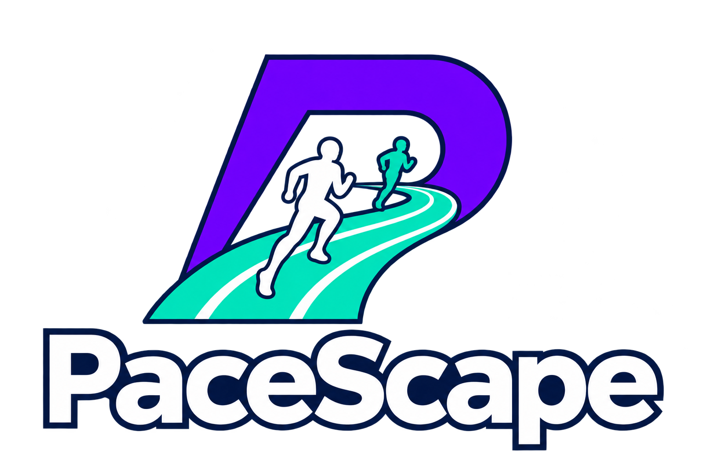
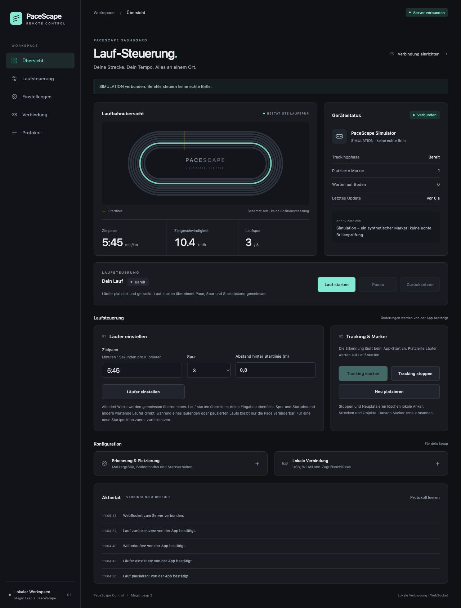

<div align="center">

  

  <h3>Dein Lauftraining. Direkt unter Kontrolle.</h3>
  <p>PaceScape Control · Die lokale Steuerungswebsite für deine Magic Leap 2.</p>

  
  
  
  

  <br><br>
  <a href="#die-idee">Die Idee</a> &nbsp;·&nbsp;
  <a href="#entwicklungsstand">Entwicklungsstand</a> &nbsp;·&nbsp;
  <a href="#schnellstart">Schnellstart</a> &nbsp;·&nbsp;
  <a href="docs/setup.md">Dokumentation</a> &nbsp;·&nbsp;
  <a href="https://github.com/kaanguen/PaceScape">Unity-Projekt</a>

</div>

---

## Zugehöriges Unity-Projekt

Die App für die Magic Leap 2 und der Unity-WebSocket-Client liegen im separaten Repository **[PaceScape](https://github.com/kaanguen/PaceScape)**. Dieses Repository enthält den lokalen Server und das Web-Dashboard zur Steuerung der App.

## Die Idee

**PaceScape Control** bringt die Steuerung der PaceScape-App auf deinen Rechner. Über eine lokale **WebSocket-Verbindung** stellst du Pace und Startposition ein, steuerst das Tracking und siehst den Zustand der **Magic Leap 2**.

| 🏃 Tempo einstellen | 🛤️ Platzierung steuern | 🥽 App im Blick |
| :---: | :---: | :---: |
| Pace, Spur und Startposition gemeinsam einstellen. | Platzierten Läufer bewusst starten, pausieren und zurücksetzen. | Trackingphase, Marker und Meldungen direkt sehen. |

Das Dashboard nutzt ein schlichtes Dark-Mode-Design mit türkisfarbenen Akzenten, Seitenleiste und schematischer Laufbahnübersicht. Die Grafik zeigt die bestätigte Laufspur; sie ist keine Live-Positionsmessung.

<details>
  <summary>Dashboard ansehen</summary>
  <br>
  
  <p><em>Vorschau mit ausdrücklich gekennzeichneter Simulation, ohne echte Brillen- oder Trainingsdaten.</em></p>
</details>

## Entwicklungsstand

**Die lokale Steuerung ist implementiert. Die Prüfung mit der echten Brille steht noch aus.**

- **Implementiert:** Lokaler HTTP-/WebSocket-Server, deutsches Dashboard, explizites Laufstarten, Pause/Weiterlaufen und Zurücksetzen, gemeinsame Pace-/Spur-/Startabstand-Einstellungen, Tracking starten/stoppen/neu platzieren sowie Erkennungs- und Bodeneinstellungen.
- **App-Anbindung:** Die passende Unity-Anbindung liegt im PaceScape-Projekt unter `Assets/Scripts/RemoteControl/`. Ein erfolgreicher Befehl wird erst nach Bestätigung der App angezeigt; ein Tracking-Start muss anschließend über die Statusmeldungen beurteilt werden.
- **Geprüft:** 13 Server-/Simulatortests bestanden; Start mit gemeinsamen Einstellungen, Pause, Pace-Änderung, Weiterlaufen und Zurücksetzen im Browser mit der Test-Brille bestätigt.
- **In Prüfung:** Unity-Kompilierung, Unity-Tests und die Verbindung sowie tatsächliche Wirkung auf Magic Leap 2. Für die App-Anbindung ist ein neuer Geräte-Build nötig.
- **Noch nicht vorhanden:** BLE-, Laufband-, Herzfrequenz-, Trainingsplan- und Live-Messdatenfunktionen.

## So steuerst du den Lauf

1. **Verbinden und platzieren:** Die aktualisierte App mit dem Server verbinden und Marker/Boden erfassen. Die Erkennung startet mit der App, der platzierte Läufer bleibt stehen.
2. **Läufer einstellen:** Pace, Spur und Startabstand gemeinsam übernehmen. Im wartenden Zustand werden bereits platzierte Objekte direkt angepasst.
3. **Lauf starten:** Startet nur bei vollständig getrackten Platzierungen und übernimmt auch noch nicht gespeicherte Läufereingaben gemeinsam. Ohne Platzierung wird kein späterer automatischer Start vorgemerkt.
4. **Pause / Weiterlaufen:** Hält die Position und setzt dort fort. Weiterlaufen nutzt die bestätigten Einstellungen; Pace-Änderungen vorher mit „Läufer einstellen“ übernehmen.
5. **Zurücksetzen:** Beendet den Lauf und stellt die eingestellte Startposition wieder her. Strecke und Anker bleiben erhalten. Danach lassen sich Spur und Startabstand wieder ändern.

Die Pace bleibt im Lauf veränderbar. Spur- und Startabstandsänderungen erfordern zuerst Zurücksetzen. Trackingverlust, Hintergrundwechsel oder verlorene Serververbindung pausieren einen laufenden Lauf; nach Wiederherstellung ist bewusstes Weiterlaufen nötig. Neue Markerplatzierungen warten bis zum nächsten Ready-Zustand. Alle platzierten Objekte teilen denselben Laufzustand.

**Tracking stoppen / Neu platzieren** löscht dagegen die lokalen Platzierungen und setzt den Lauf zurück. Ein geschlossenes Browser-Tab pausiert den Lauf nicht, solange App und Server verbunden bleiben.

## Schnellstart

Voraussetzung: **Node.js 22 oder neuer**. Im Repository-Ordner:

```sh
npm ci
npm start
```

Die Website unter **[localhost:8787](http://localhost:8787)** öffnen. Der Server ist standardmäßig im lokalen Netz erreichbar; Website und App verbinden sich über WebSockets.

Für die Brille per USB: aktualisierte PaceScape-App installieren, USB-Debugging freigeben und bei verfügbarem ADB die Weiterleitung setzen:

```sh
adb reverse tcp:8787 tcp:8787
```

Danach die App starten. Sie verwendet standardmäßig `ws://127.0.0.1:8787/ws`. Ohne USB-Weiterleitung bezeichnet localhost auf der Brille die Brille selbst.

**Ohne Brille ausprobieren:** In einem zweiten Terminal `npm run simulate` starten. Die Test-Brille ist im Dashboard als Simulation gekennzeichnet und muss vor dem Verbinden des echten Geräts beendet werden. `npm test` führt die Server-Tests aus; Strg+C beendet den jeweiligen Prozess.

USB-Einrichtung, WLAN-Betrieb ohne Zugriffsschlüssel und Fehlerverhalten sind in der **[Einrichtungsanleitung](docs/setup.md)** beschrieben. Lokales `ws://` ist unverschlüsselt; für WLAN ein vertrauenswürdiges Netz ohne öffentliche Portfreigabe verwenden.

---

<p align="center">
  <a href="docs/setup.md">Einrichtung &amp; Geräteprüfung</a> &nbsp;·&nbsp;
  <a href="PROTOCOL.md">WebSocket-Protokoll</a>
</p>


## Verbindung ohne Zugriffsschlüssel

Der Server lauscht jetzt standardmäßig auf `0.0.0.0:8787` und akzeptiert App und Dashboard ohne Zugriffsschlüssel. `npm start` genügt. Die App verwendet `ws://RECHNER-IP:8787/ws`; ein eventuell noch gesendeter alter Schlüssel wird ignoriert. `ACCESS_TOKEN` hat keine Wirkung mehr. Die lokale IP muss vom Gerät erreichbar sein. Alle Teilnehmer im erreichbaren lokalen Netz können die App steuern; den Port nicht öffentlich freigeben. Frühere Angaben zur verpflichtenden Schlüsselprüfung gelten nicht mehr.


Die Live-Geschwindigkeit wird über einen Slider im Bereich Läufer einstellen in km/h gesetzt und automatisch in Pace umgerechnet. Gültige Eingaben werden nach einer kurzen Eingabepause automatisch an die App übertragen; die bestätigte Zielpace wird separat angezeigt. Spur und Startabstand werden dadurch nicht verändert. Nach einem Verbindungsabbruch werden keine vorgemerkten Pace-Befehle wiederholt.

Am Slider lässt sich zwischen **km/h** und **Pace (min/km)** umschalten. Der Einheitenwechsel verändert das Zieltempo nicht und sendet keinen Befehl. Im Pace-Modus wird in Sekunden pro Kilometer eingestellt; die automatische Übertragung bleibt aktiv.

## FTMS-Laufband verbinden

Mit dem aktualisierten PaceScape-Gerätebuild im Bereich **Laufband verbinden** nach Bluetooth-Geräten suchen, Berechtigungen auf der Brille erlauben, das Laufband anhand von Name/Kennung auswählen und verbinden. Auf die gemeldete Geschwindigkeit warten, dann den virtuellen Lauf bewusst starten. Die Laufbanddaten messen ausschließlich deinen Fortschritt. Der Ghost nutzt voreingestelltes Tempo oder All-time PR unabhängig von deinem aktuellen Tempo. Ein bereits laufender Server muss nach diesem Update neu gestartet werden.

Unterstützt wird das Lesen von FTMS Treadmill Data (1826/2ACD); keine Steuerung des realen Motors. Die optionale Gesamtdistanz ist der rohe Laufbandzähler. Bluetooth läuft auf der Brille; der Unity Editor und der bestehende Simulator führen keinen BLE-Scan aus. Das konkrete Domyos-Modell und die Hardware-Verbindung müssen noch geprüft werden. Protokoll siehe [PROTOCOL.md](PROTOCOL.md).

## Distance comparison and all-time treadmill PRs

Updated clients advertise `comparisonControlVersion: 1`, `activeRunnerPace` and `performance` with measurement distance, current lap/time/average, lap history/validity, session best, real all-time best, separate optional demo time, record list and storage/pending status. `runner.comparison` accepts exactly `{ "comparisonDistanceMetres": 5000, "useDemoRecords": false }` (1–1000000 integer metres); distance changes require Ready and demo changes require Ready/Paused. `runner.mode` accepts only `FixedPace` (the default) or `AllTimePersonalBest` and requires `ghostControlVersion: 1`. FixedPace always uses the preset; all-time mode uses the persisted distance record. Current-run bests remain statistics only.

In the dashboard choose 400-m rounds or a custom kilometre distance under **Runden & Vergleichsdistanz**. Fresh belt telemetry is measured independently of avatar movement. Known zero-speed time counts; incomplete/unknown intervals never form records across pauses or data gaps. The current selected distance is evaluated, including windows within longer runs. Real PRs are saved on the headset across sessions and only replaced by faster measured efforts. Fictitious examples for 400 m / 5 km / 10 km are opt-in, labelled, and never stored as measured PRs. Reset clears current-run measurements, preserving real records and settings. Mode changes retain completed measurements and pause motion.

The existing simulator exercises settings and demo targets but does not generate real measurements or persisted records. A new Android build and server restart are required. No Strava connection, official-race certification or cloud sync is provided.

## Ghost-only avatar

The avatar is an independent ghost with exactly two references: `FixedPace` (default, preset speed) and `AllTimePersonalBest` (the persisted distance record, average pace). Clients advertise `ghostControlVersion: 1`; both dashboard selection and the relay require this capability. `FollowInput`, `TempoRunner`, side-by-side modes and `treadmill.manual` are rejected. The BLE panel is exclusively for user measurement. The ghost never directly follows live belt speed or a current-run best. User progress and records never derive from ghost motion. Existing tracking/app/server pause rules remain active. Mode changes pause without rewinding; reset retains the selected reference. A side-by-side companion is deferred.
